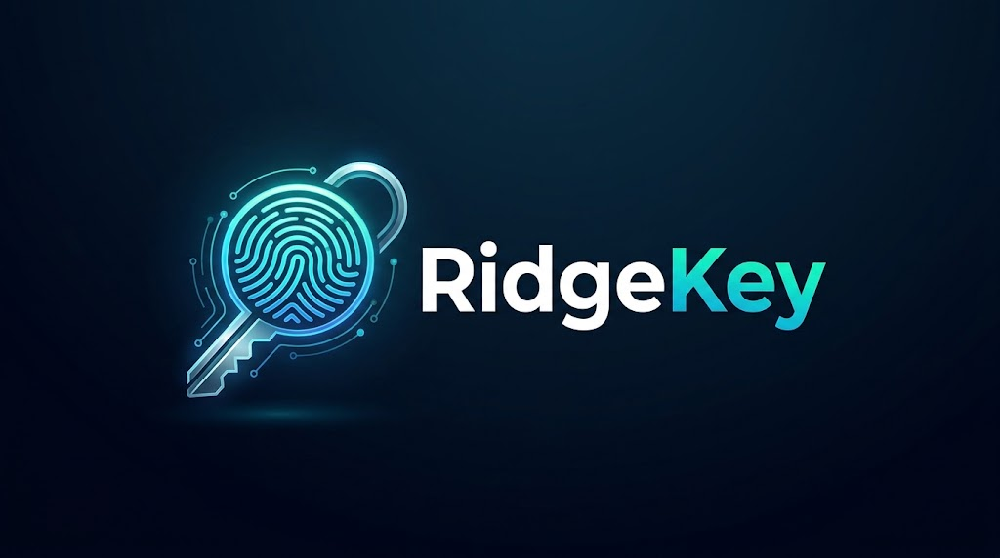
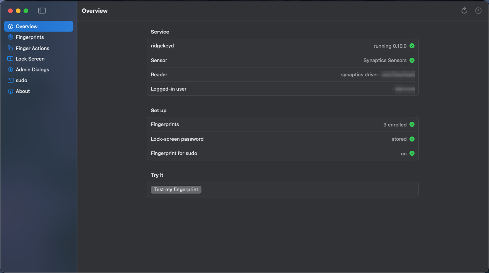
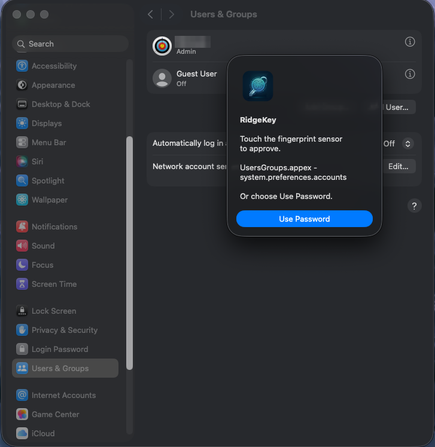
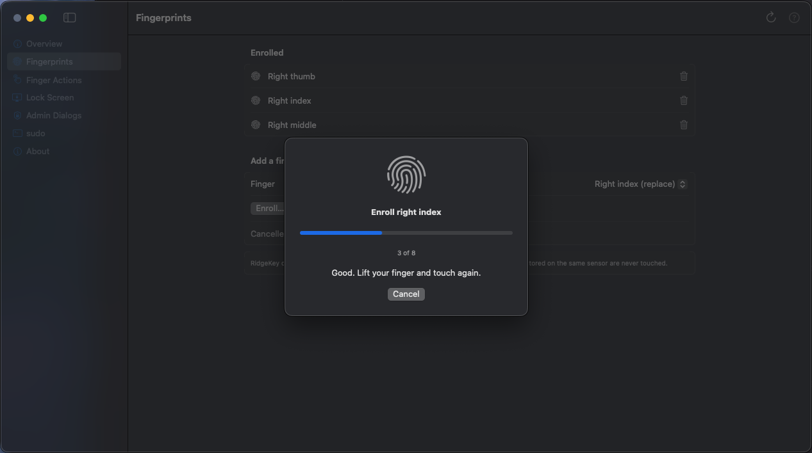
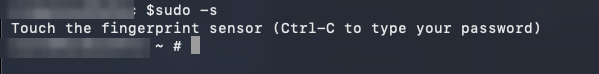
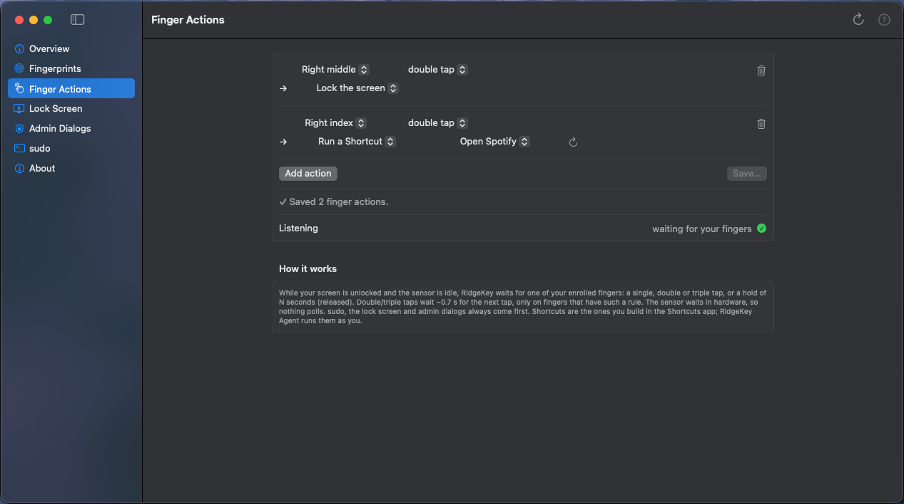

<p align="center"></p>

<p align="center"><b>Touch ID-style fingerprint login for macOS on laptops whose reader macOS doesn't support.</b></p>

<p align="center">
  <a href="https://github.com/labrouss/RidgeKey/actions/workflows/macos-build.yml"></a>
  <a href="https://github.com/labrouss/RidgeKey/releases/latest"></a>
  <a href="LICENSE"></a>
</p>

<p align="center">
  <a href="https://labrouss.github.io/RidgeKey/"><b>Documentation</b></a> ·
  <a href="https://github.com/labrouss/RidgeKey/releases/latest"><b>Download</b></a> ·
  <a href="CHANGELOG.md">Changelog</a> ·
  <a href="https://labrouss.github.io/RidgeKey/troubleshooting.html">Troubleshooting</a>
</p>

---

Hackintosh laptops often have a perfectly good fingerprint reader that macOS ignores. RidgeKey
puts it to work: enroll your fingers in a small settings app, then touch the sensor wherever
macOS would ask for your password. Built on [libfprint](https://fprint.freedesktop.org/), for
**match-on-chip** readers - the fingerprint is stored and matched inside the reader.

<p align="center"></p>

## What you can do

| Feature | Guide |
|---|---|
| 🔓 **Unlock the lock screen** with a touch - display on or asleep | [Lock screen](https://labrouss.github.io/RidgeKey/lock-screen.html) |
| 🛡️ **Approve admin dialogs** - System Settings locks, installers, "wants to make changes" | [Admin dialogs](https://labrouss.github.io/RidgeKey/admin-dialogs.html) |
| ⌨️ **Approve `sudo`** in Terminal | [sudo](https://labrouss.github.io/RidgeKey/sudo.html) |
| 👆 **Finger actions** - tap, double/triple tap or hold a finger to lock the screen or run a Shortcut | [Finger actions](https://labrouss.github.io/RidgeKey/finger-actions.html) |
| 🗂️ **Manage fingerprints** - enroll with live progress, delete, confirmed by a finger or your password | [Fingerprints](https://labrouss.github.io/RidgeKey/fingerprints.html) |

Your password **always keeps working**: a wrong finger, a timeout or **Use Password** brings back
the normal macOS prompt.

<table>
  <tr>
    <td></td>
    <td><br><br>
        </td>
  </tr>
  <tr>
    <td colspan="2"></td>
  </tr>
</table>

## Install

1. Download **`RidgeKey-<version>.pkg`** from the [latest release](https://github.com/labrouss/RidgeKey/releases/latest).
2. Open it. It isn't signed with an Apple Developer ID, so the first time right-click → **Open**
   (or System Settings → Privacy & Security → **Open Anyway**). The installer warns if it finds
   no supported reader.
3. Open **RidgeKey** from Applications → **Fingerprints** → **Enroll…**, then switch on the
   features you want.

Upgrades keep your fingers and settings. Terminal install, uninstall and details:
[Install guide](https://labrouss.github.io/RidgeKey/install.html).

## Supported readers

| Driver | Vendor (USB id) | Status |
|---|---|---|
| `synaptics` | Synaptics (06cb) | ✅ tested: **06cb:00f0** (HP EliteBook 840 G8, macOS Tahoe) · ✅ **06cb:00bd** (reported by a user) |
| `goodixmoc` | Goodix (27c6) | untested - reports welcome |
| `elanmoc` | Elan (04f3) | untested |
| `fpcmoc` | FPC (10a5) | untested |
| `egismoc` | Egis (1c7a) | untested |
| `focaltech_moc` | FocalTech | untested |
| `realtek` | Realtek (0bda) | untested |

Each release lists the exact USB IDs in `supported-devices.txt`. Tried another reader?
[Open an issue](https://github.com/labrouss/RidgeKey/issues/new) - working or not.

## Safe alongside Windows and the BIOS

Laptop readers often hold Windows Hello and BIOS fingerprints in the same storage. RidgeKey
**never erases the reader's whole storage**: it only deletes fingerprints it enrolled itself, and
every build removes each driver's erase-everything command (checked in CI; see
[`patches/libfprint/`](patches/libfprint/)).

Changing fingerprints or finger actions needs an enrolled finger or your password, and only the
installed RidgeKey app and `ridgekeyctl` (signatures recorded at install) may manage prints.
Your stored password stays in the System keychain, readable only by root.

## How it works

```
 RidgeKey.app ─┐                       ┌─ lock screen  (RidgeKey Agent)
 ridgekeyctl  ─┼─ XPC ─▶ ridgekeyd ────┼─ admin dialogs (authorization plugin)
               │        (libfprint)    ├─ sudo          (pam_ridgekey)
               │            │          └─ finger actions (lock / Shortcuts)
               │        USB reader
```

One root daemon, `ridgekeyd`, owns the reader; everything else asks it over XPC.
Developers: [build, CI and architecture](https://labrouss.github.io/RidgeKey/development.html) ·
[technical reference](https://labrouss.github.io/RidgeKey/ridgekeyd.html).

## License

RidgeKey's own code is **MIT** (see `LICENSE`). libfprint, GLib, gusb and libusb are
LGPL-2.1-or-later, linked dynamically; our libfprint patches are LGPL as well.

Not affiliated with or endorsed by Apple, Synaptics, HP or the libfprint project. Inspired by
[hack-touchid](https://github.com/hackintosh-user/hack-touchid); it shares no code with it.
