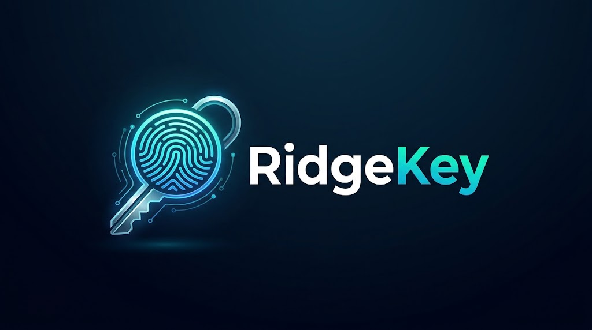

# RidgeKey

Fingerprint authentication for macOS on laptops whose fingerprint reader macOS does not support -
typically Hackintosh laptops with a **match-on-chip** reader (the fingerprint is stored and matched
inside the reader). Built on [libfprint](https://fprint.freedesktop.org/).

| With RidgeKey you can | Page |
|---|---|
| Enroll fingers and manage them | [Fingerprints](fingerprints.md) |
| Unlock the lock screen with a touch (display on or asleep) | [Lock screen](lock-screen.md) |
| Approve `sudo` in Terminal | [sudo](sudo.md) |
| Approve admin dialogs (System Settings locks, installers) | [Admin dialogs](admin-dialogs.md) |
| Tap, double/triple tap or hold a finger to lock the screen or run a Shortcut | [Finger actions](finger-actions.md) |

Your password **always keeps working**: every fingerprint feature falls back to it.

## Quick start

1. [Install](install.md) the `.pkg` from the latest
   [release](https://github.com/labrouss/RidgeKey/releases).
2. Open **RidgeKey** from Applications → **Fingerprints** → enroll a finger.
3. Turn on what you want: Lock Screen, sudo, Admin Dialogs, Finger Actions.

Something not working? See [Troubleshooting](troubleshooting.md).

## Supported readers

Tested: **Synaptics 06cb:00f0** (HP EliteBook 840 G8, macOS Tahoe). RidgeKey also includes
libfprint's other match-on-chip drivers - Goodix, Elan, FPC, Egis, FocalTech, Realtek - untested
so far. Every release lists the exact USB IDs in `supported-devices.txt`, and the installer warns
when none is connected. Reports for other readers are welcome on
[GitHub](https://github.com/labrouss/RidgeKey/issues).

## Safety

Laptop readers often store Windows Hello and BIOS fingerprints too. RidgeKey **never erases the
reader's whole storage**: it only deletes fingerprints it enrolled itself, and every build removes
the drivers' erase-everything commands (see [Technical reference](ridgekeyd.md)).
